<p align="center">
  
</p>

<p align="center">
  <a href="LICENSE"></a>
  
  
  
  
  
</p>

<p align="center">
  <b><a href="#-what-it-does">What it does</a></b> ·
  <b><a href="#-the-engine">The engine</a></b> ·
  <b><a href="#-attack-categories">Categories</a></b> ·
  <b><a href="#-the-ip-inspector">IP Inspector</a></b> ·
  <b><a href="#-the-dashboard">Dashboard</a></b> ·
  <b><a href="#-email-alerts-with-selfmail">Email alerts</a></b> ·
  <b><a href="#-install">Install</a></b>
</p>

---

**Bulwark** guards what you publish from home. It runs *inside* your gateway and judges every request before your app sees it, in microseconds: who is asking (bans, 250 000+ blocklisted addresses, threat lookups), what they are asking for (an attack engine with 21 categories and 44 known CVE exploits, seeing through encodings) and how they behave (wordlist scanning, brute force, floods). Attackers are banned on every tunnel at once. Its own dashboard shows every request in full, warns about waves before they peak, graphs the patterns, keeps your blocklist, reports attackers to the vendors that missed them, and inspects any address down to its registry record.

It installs as an addon in **Aegis × Burrow** (on by default there) and in **Selkies Forge**, and runs as an app of its own. Node.js 18+, no dependencies.

## ✦ What it does

<table>
<tr>
<td width="33%" valign="top">

**🛡 Judged on the spot**<br>
The guard answers inside the gateway, synchronously: banned, blocklisted, a payload, or through. About 3 µs for a request it has seen the shape of, under 30 µs for one it hasn't. It never waits on the network.

</td>
<td width="33%" valign="top">

**🔬 Sees through encodings**<br>
`%252e%252e%252f`, `%c0%af`, `%u2215`, fullwidth `．．／`, `&lt;script&gt;`, `${${::-j}ndi:…}`: decoded the way your app will see them, then matched. Hiding a payload makes it count more, not less.

</td>
<td width="33%" valign="top">

**🧭 Named, not just blocked**<br>
Every hit has a category (SQLi, SSRF, RCE, web shells, IoT botnets…), a severity, its MITRE ATT&CK and OWASP references, and its CVE when it is a known exploit.

</td>
</tr>
<tr>
<td valign="top">

**📈 Behaviour, per address**<br>
Wordlist scanning (a burst of not-founds across many paths), login hammering and credential stuffing, floods, method fuzzing: counted per minute in bounded memory and scored with everything else.

</td>
<td valign="top">

**🌊 Waves, seen coming**<br>
Surges against a learned baseline, campaigns (many addresses, one playbook), clusters from one network, names suddenly found by scanners, each with a forecast. A critical wave turns on strict mode.

</td>
<td valign="top">

**🔎 Inspect any address**<br>
Reverse DNS, RDAP, RIPEstat, Team Cymru, Shodan InternetDB, GreyNoise, OTX, AbuseIPDB, eight DNS blocklists, Tor and two geolocation services, plus everything Bulwark saw: one report with a scored verdict.

</td>
</tr>
</table>

**Never you.** Private addresses, addresses you signed in from in the last 30 days, any request carrying your session or one of your device keys, and your allow list are never banned, and your own requests carry no attack labels. Signing in lifts a ban on your address. Known business services (GreyNoise "benign": search engines, research scanners) are never banned for probes or behaviour. The machine's *own* public address is neither trusted nor banned, because proxyware sends other people's traffic out through it.

## ✦ The engine

Every request goes through four steps in the guard (`sensor/guard.mjs`, `core/payloads.mjs`):

1. **Normalize** (`core/normalize.mjs`). The path and every query value are decoded the way the app behind will decode them: URL decoding up to three passes, IIS `%uXXXX`, overlong UTF-8 (`%c0%af` → `/`), invalid bytes kept as Latin-1, look-alike and "best-fit" characters folded (fullwidth `．／＼`, `∕`, the soft hyphen behind CVE-2024-4577), HTML entities, null bytes, backslashes, `+` as a space, and dot segments resolved (`/a/./b/../../c`, Tomcat's `..;/`). What had to be undone is remembered.
2. **Match.** 100+ signatures run on the path, the query and the User-Agent / Referer where each belongs. Their regexes are read once at start for the literals they cannot match without, and all those literals go into one Aho-Corasick automaton: a request that contains none of them (nearly all traffic) costs one pass over its characters, and only the regexes whose literal is present are asked. Results are cached per path and per User-Agent (bounded).
3. **Lexers** (`core/lexers.mjs`). SQL injection and XSS are judged by shape, libinjection-style: each value is tokenized as SQL as it is and as if inside `'…'` and `"…"`, folded into a fingerprint (`s&sos` is `' OR '1'='1`) and compared with the shapes injections take: tautologies, `UNION SELECT`, stacked queries, comments that cut the query short, time- and error-based functions, `ORDER BY` probing. XSS looks for tags the way a browser's tokenizer does, event handlers, `javascript:` URLs, and attribute or string breakouts with a script sink. Plus SSRF (cloud metadata, loopback, `gopher://`, `file://`), Log4Shell lookups even when nested (`${${lower:j}ndi:…}`), serialized Java, PHP and .NET objects, and protocol anomalies (unknown methods, `TRACE`, `CONNECT` and absolute-URI proxy probes, CRLF header injection, oversized URLs, parameter floods).
4. **Score**, Core Rule Set style. Each distinct hit adds its severity's points (critical 5, high 4, medium 3, low 2, info 0). **5 or more is a payload**: dropped with a 404, it never reaches the app. Evasion that hid a hit adds 2, so `<iframe>` alone is suspicious but `%253Ciframe…` is an attack.

Then the address: a payload adds 5 to its score, other hits their points. **10 bans it** (two payloads), and so does any hit from an address with a mark against it (a blocklist, a bad lookup), the first payload during a critical wave, or credential stuffing (25 sign-in attempts in a minute). Probes for software that isn't here (`/wp-login.php` on a site without WordPress) count **only when the app answers "not here"** (4xx): if your app serves it, it was a visitor, not a scanner. Behaviour is counted per minute: 25 not-founds across 15+ top-level paths is content discovery, 10 failed sign-ins is brute force, 1 200 requests is a flood.

False positives are worse than misses, so the engine is tested both ways (`test/engine.test.mjs`): encoded attacks of every category are caught, and SPA assets, OAuth callbacks with nested encoded URLs, JWTs and signed links, Termix and Selkies websockets, WebDAV methods, Prometheus and GraphQL queries, searches like *"how to select from table where id = 1"* or *O'Reilly*, and file managers' odd file names (`Résumé (2024) [draft].docx`, `100% done.txt`, Latin-1 bytes) are left alone, as are 20 000 random tokens and links in a fuzz test.

**Speed.** 100 000 decisions take about 0.6 s on a Raspberry Pi (a few µs each); URLs never seen before stay well under 100 µs. Every map is bounded.

## ✦ Attack categories

| Category | What it catches | MITRE ATT&CK | OWASP | AbuseIPDB |
|---|---|---|---|---|
| Recon & scanning | probes for software that isn't here, wordlist scanning, attack tools (`sqlmap`, `nuclei`…) | T1595 | – | 14, 21 |
| Secret & config hunting | `.env`, `.git/`, cloud and SSH keys, backups, dumps, debug pages, Spring actuators | T1552.001 | A05 | 15, 21 |
| Path traversal / LFI | `../`, encoded or folded, `/etc/passwd`, `php://filter` | T1190 | A01 | 15, 21 |
| Remote code / command injection | shell commands, `${IFS}`, PHP code, OGNL, prototype pollution | T1059 | A03 | 15, 21 |
| SQL injection | tautologies, `UNION SELECT`, stacked, blind | T1190 | A03 | 16, 21 |
| Cross-site scripting | tags, handlers, `javascript:`, breakouts | T1189 | A03 | 21 |
| SSRF | cloud metadata, loopback, internal hosts, odd schemes | T1552.005 | A10 | 15, 21 |
| XXE | `DOCTYPE` / `ENTITY` declarations, XInclude | T1190 | A05 | 15, 21 |
| Template injection | `{{7*7}}`, Jinja / Twig / Freemarker / Velocity / SpEL gadgets | T1190 | A03 | 15, 21 |
| Insecure deserialization | Java (`rO0AB`, `aced0005`), PHP objects, .NET gadgets, fastjson | T1190 | A08 | 15, 21 |
| Log4Shell / JNDI | `${jndi:…}`, obfuscated, in the URL, User-Agent or Referer | T1190 | A06 | 15, 21 |
| Known CVE exploits | 44 tagged: PHPUnit, Spring4Shell, Struts, Confluence, Fortinet, F5, Citrix, Ivanti, Exchange ProxyShell, Apache 2.4.49, Ignition, PHP-CGI, WebLogic, Shellshock… | T1190 | A06 | 15, 21 |
| Web shells & backdoors | alfa, wso, c99, b374k…, PHP in `.well-known` or uploads | T1505.003 | A08 | 15, 20, 21 |
| Brute force & credential stuffing | admin panels and CMS logins asked for, sign-in hammering | T1110 | A07 | 18, 21 |
| Protocol abuse & smuggling | CRLF injection, proxy probes, `TRACE`, unknown methods, encoding evasion | T1190 | A05 | 15, 21 |
| Phishing kits | kits looked for (or planted) | T1583.001 | – | 21 |
| Cloud & container APIs | Docker, Kubernetes, Elasticsearch, metadata, pprof | T1552.005, T1610 | A05 | 15, 21 |
| IoT & botnets | router, camera and DVR exploits; Mirai / Mozi droppers | T1584.005 | – | 15, 23 |
| Crypto-miner droppers | xmrig, kinsing, `stratum+tcp://` | T1496 | – | 15, 21 |
| Bots & scrapers | scanners and scraping libraries by name (a label, never a ban) | T1595 | – | 19 |
| DoS & floods | request floods, oversized URLs, parameter bombs | T1498, T1499 | – | 4 |

Categories are shown everywhere an attack is: the live log (filter by category), each address, the Overview ("what they're after"), Patterns (by category, then the workflow) and the Lists page, which has the full taxonomy with every signature. Reports to AbuseIPDB use the categories' numbers and name them in the comment.

## ✦ The IP Inspector

Type or paste any address (or open it from the log, the blocklist or the Patterns graph and choose **Full inspection**). The app asks, in parallel and on demand only:

| Source | What it gives |
|---|---|
| Reverse DNS | PTR names, each confirmed forward (does the name lead back here?) |
| Team Cymru (DNS) | origin AS, prefix, registry, allocation date |
| RDAP (rdap.org → the RIR) | owner, abuse contact, range, registration and change dates |
| RIPEstat | prefix and holder, routing visibility, first seen, geolocation, abuse contact, its blocklist widget, the AS's announced prefixes, RPKI |
| Shodan InternetDB | open ports, software (CPEs), known vulnerabilities, tags |
| GreyNoise community | internet-wide scanner, malicious, or a known service |
| AlienVault OTX | threat-intelligence pulses and malware families |
| AbuseIPDB (your free key) | confidence, reports, categories and recent comments |
| DNS blocklists | Spamhaus ZEN, DroneBL, SpamCop, blocklist.de, PSBL, UCEPROTECT, Mailspike, s5h |
| Tor | the exit list, and Onionoo for relay details |
| StopForumSpam, IPinfo, ipwho.is | spam reports, geolocation, ISP |

…and Bulwark's own knowledge: its requests here (with a timeline), categories and CVEs it tried, the ban and why, the lists it is on, the waves and campaigns it joined, your devices, and its neighbours seen here (same /24, same network).

The report opens with a **risk score from 0 to 100 and every reason with its weight** (`+50 AbuseIPDB confidence 100%`, `−30 a known service (GreyNoise)`…), then the facts, each source as a card with its raw JSON one click away, the neighbours, deep links to AbuseIPDB, GreyNoise, Shodan, Censys, VirusTotal, OTX, ThreatFox, URLhaus, Talos, CrowdSec, X-Force, Spamhaus, IPinfo, bgp.he.net, RIPEstat and more (opened without a referrer), and a list of exactly what left the machine. **Export JSON** saves the whole report.

Every lookup has a timeout, every answer is cached per source (one to 24 hours), each host is asked politely (one request at a time, spaced), and nothing is sent but the address being inspected (and, for routing, its network).

## ✦ The dashboard

- **Overview:** traffic by what happened, attack patterns over time, what attackers are after (categories), top patterns, networks, countries and strangers
- **Live log:** every request, live, filterable by decision, category or pattern; a row opens everything, including every hit, its severity and CVE
- **Waves:** open and past waves with members and forecasts, strict mode, the baseline
- **Patterns:** attacks by category, then a workflow from networks to patterns to what Bulwark did, every pattern ranked, the campaigns
- **Inspector:** the IP Inspector
- **Devices**, **Blocklist** (exportable as text, CIDR, nginx, iptables, CSV, JSON), **Lists** (the feeds and the taxonomy), **Vendors**, **Settings**

Inside Aegis × Burrow it lives at `https://<dashboard>/__gate/bulwark/`, behind the gateway's login. Standalone, it's at `http://127.0.0.1:4370/?k=<key>` (`bulwark url`). It runs under a strict Content-Security-Policy, with no inline scripts and nothing loaded from elsewhere.

## ✦ Email alerts (with selfmail)

When the **selfmail** addon (a mail server for your own domain) is installed and running, Settings gets an **Email alerts** section; without it, nothing about email shows anywhere. It is off until you turn it on.

- **What you get:** waves and surges; new campaigns and strict mode; critical events (no guard connected for 5 minutes, the app restarting after a crash or failing again and again); and, if you ask, a daily digest at 8:00. Each can be turned off, and the recipient changed (it defaults to selfmail's own address). **Send a test email** shows it works.
- **What's in one:** requests a minute against the hour before, attacks a minute, how many of the wave's addresses are banned, the top networks (with their AS) and patterns, strict mode, the forecast, and a link to the dashboard when Bulwark knows it (Aegis tells it; or set `"dashboard"` in `bulwark.json`). HTML that every mail client shows the same (tables, inline styles, no images or web fonts), with a plain-text twin.
- **How often:** a wave goes out within seconds, then at most one email every 15 minutes: everything in between is summed up in the next one (a wave turning critical waits only a minute). Critical events at most every 30 minutes, and never more than 12 emails an hour in all. If selfmail says to slow down, Bulwark waits 15 minutes and keeps what it had.

**How it finds selfmail:** selfmail announces itself in the Weft mesh (`~/.config/weft/mesh/selfmail.json`, or `$MESH`), refreshed every 30 s; an entry older than 90 s means it isn't running. Bulwark posts to the `notify.url` it gives, with the key from its `notify.keyFile` (plain http only to this machine), and selfmail sends it from `"Bulwark" <bulwark@your domain>`. Ntfy, the webhook and Aegis's bell work as before, with or without email.

## ✦ How it fits together

**The guard** runs inside the gateway (Burrow loads `sensor/burrow.mjs` as an extension): the engine, bans, about 250 000 blocklisted addresses held as sorted ranges (a binary search per list), and behaviour. When the response is done, the host's `observe` hook tells it what the app answered (the 4xx-aware signals) and sends one log line to the app.

**The app** (`bulwark.service`) does everything slow, behind the request: lookups of new addresses (Spamhaus, DroneBL, StopForumSpam, GreyNoise for probes), list updates every 5 s, waves and forecasts, the full log (the last 50 000 in memory, every one on disk for 30 days), vendor coverage and AbuseIPDB reports, the Inspector, and the dashboard.

The guard never waits on the network; if the app is down it keeps enforcing on the last state it saw.

> **For hosts:** the guard reads `method`, `path` (with the query), `ua`, `referer`, `lang`, `proto`, `host` and `access` from the request info, and the status from `observe`. Header-level checks (request smuggling with `Content-Length` + `Transfer-Encoding` or a duplicate `Content-Length`, `Host` header abuse, `x-middleware-subrequest` for CVE-2025-29927, cookies such as GlobalProtect's `SESSID` for CVE-2024-3400) need the host to pass those headers too.

## ✦ Install

- **Aegis × Burrow 2.15+** installs it by itself. Otherwise go to Burrow → Addons and add `https://github.com/alexd-aero/bulwark`.
- **Selkies Forge:** Addons → add the same link.
- **By hand:** `git clone https://github.com/alexd-aero/bulwark && bash bulwark/forge/install.sh`

It needs Node.js 18+ and nothing else. It runs as a systemd user service when there is one.

```
bulwark status            what it guards, bans, waves
bulwark url               the dashboard, with its key
bulwark check IP          everything about an address
bulwark ban IP [why]      bulwark unban IP · bulwark allow IP
bulwark log [-f]          the latest requests (follow)
```

`~/.config/bulwark/bulwark.json` holds the port and key (and, optionally, `dashboard`: the dashboard's URL for links in emails). `~/.local/share/bulwark/` holds `feeds/` (the lists), `asn/` (the network database, from iptoasn.com), `logs/` (every request), `state/` (bans, settings, alerts, profiles, emails) and `run/sensor.sock` (guard ↔ app).

MIT licensed.
